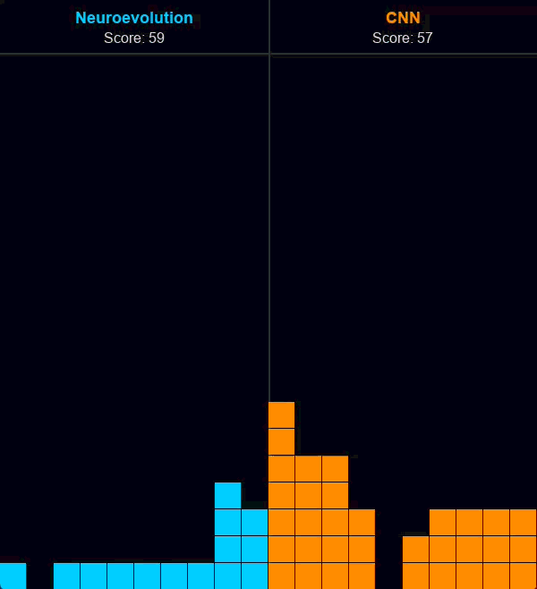
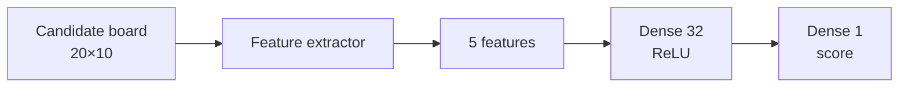
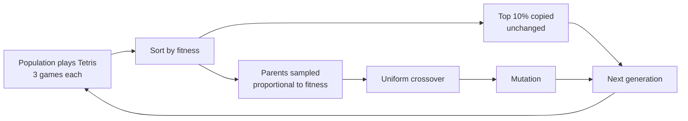
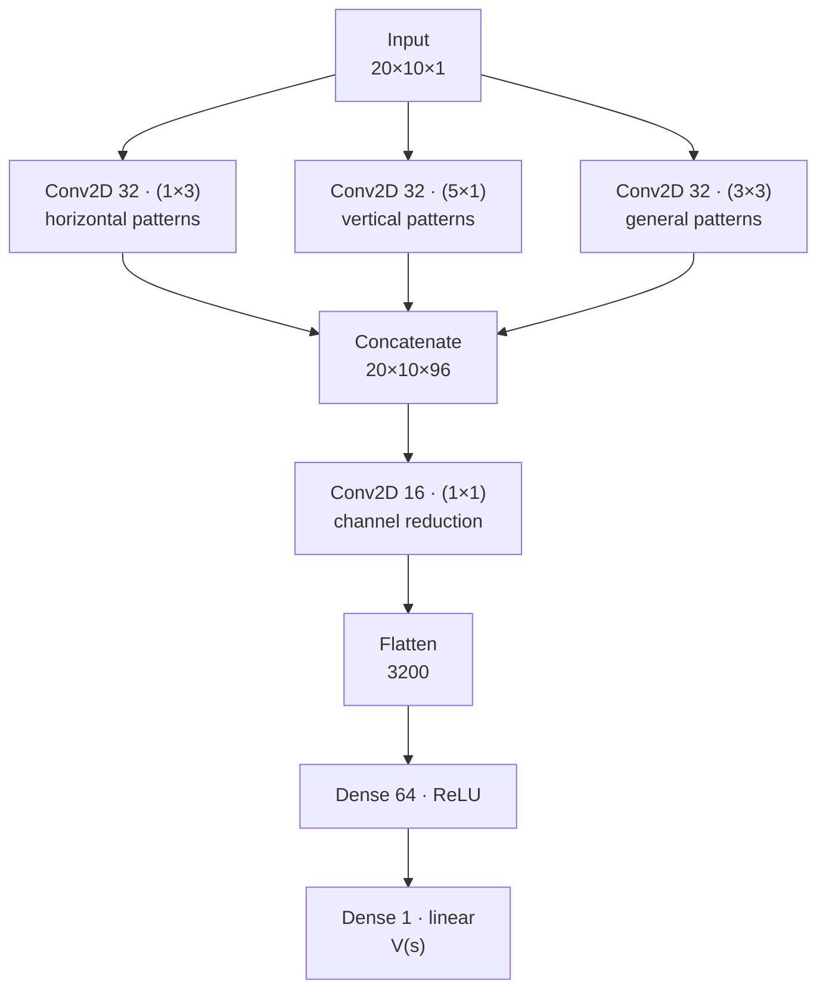
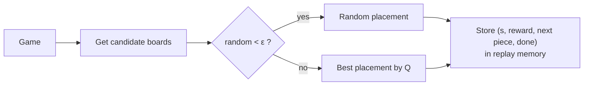
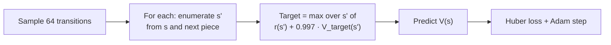
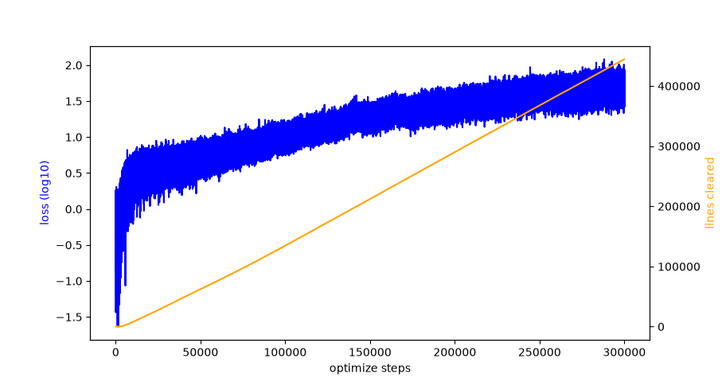

# Neuroevolution vs. CNN on Tetris

A small study comparing two learning approaches on the same Tetris environment:

- **Neuroevolution**: a tiny neural network trained with a genetic algorithm on hand-crafted board features.
- **CNN + DQN**: a convolutional network that looks at the raw board and is trained with deep Q-learning.

We wanted to see which one learns faster, plays better and is easier to build. This project was made for the summer bootcamp of the **DataTeam / ITU ACM Student Chapter**.

**Members:** Yusuf Samed Ala, Bahadır Yiğit

<p align="center">
  <!-- Put the side-by-side recording from main.py here -->
  
</p>

---

## Contents

- [The Environment](#the-environment)
- [Approach 1: Neuroevolution](#approach-1-neuroevolution)
- [Approach 2: CNN + DQN](#approach-2-cnn--dqn)
- [Results](#results)
- [Limitations](#limitations)
- [Running the Project](#running-the-project)
- [Project Structure](#project-structure)

---

## The Environment

[Tetris.py](Tetris.py) is our own Tetris implementation on a 10×20 board. Pieces come from a 7-bag randomizer.

Neither agent presses keys frame by frame. Each turn, the game lists **every final placement** of the current piece: every rotation in every column, dropped straight down. The agent picks one of these resulting boards. A turn usually has 10 to 34 candidate placements.


The two agents share this setup. They differ only in how they score a candidate board.

---

## Approach 1: Neuroevolution

**Libraries:** NumPy, PyTorch (shared memory and multiprocessing), Pygame

### Network

Every candidate board goes through a feature extractor that turns it into 5 numbers. A small MLP then turns those 5 numbers into a single score.

| Feature | Meaning |
|---|---|
| Aggregate height | Sum of all column heights |
| Max height | Tallest column |
| Lines cleared | Lines cleared by this placement |
| Holes | Empty cells with a block above them |
| Bumpiness | Sum of height differences between neighbouring columns |



The network has **225 parameters**: 5→32 weights, 32 biases, 32→1 weights and 1 bias. They are stored as one flat vector per individual.

### Genetic Algorithm



| Setting | Value |
|---|---|
| Population size | 100 |
| Games per individual per generation | 3 (fitness is averaged) |
| Fitness | `1 + lines_cleared × 100` |
| Elitism | top 10% |
| Selection | fitness-proportional (roulette) |
| Crossover | uniform, 50% per gene |
| Mutation | each gene with 15% chance, `± up to 0.4` |
| Weight range | clamped to `[-1, 1]` |
| Game cap during training | 50,000 lines |

The whole population lives in one shared-memory `torch.Tensor`, and games run in parallel across all CPU cores with `torch.multiprocessing`.

### What we tried first, and why it failed

**Raw input.** The first version fed the raw board straight into the network: 200 inputs → 32 hidden (ReLU) → 4 outputs, one per key. After about 14 hours of training it had basically not learned to clear lines. With that many parameters and such a sparse reward, the genetic algorithm had too large a search space.

**Placement-based states.** Next, we switched to scoring final placements, an idea taken from the CNN side. This removed the problem of learning raw controls. But each turn now meant scoring 10–34 full boards, so the input was still large.

**Hand-crafted features.** Last, we reduced each board to the 5 features above, in the spirit of classic heuristic Tetris players such as Pierre Dellacherie's. This was the change that made the genetic algorithm work.

**Speed.** The first implementation used a `Perceptron` class per neuron, and one generation of 400 individuals took about 7 seconds. We replaced it with a stateless `NeuralNetwork` class that reads flat weight vectors from shared memory, which made each generation much faster. See [NeuroevolutionModel.py](NeuroevolutionModel.py).

---

## Approach 2: CNN + DQN

**Libraries:** TensorFlow / Keras, NumPy, Pygame, Matplotlib

### Network

The CNN receives the raw 20×10 board and outputs a value estimate V(s) for it. Three convolution branches run in parallel, each with a different kernel shape. A 1×1 convolution then merges them.



| Layer | Output shape | Params |
|---|---|---|
| Input | 20×10×1 | 0 |
| Conv 1×3 (32) | 20×10×32 | 128 |
| Conv 5×1 (32) | 20×10×32 | 192 |
| Conv 3×3 (32) | 20×10×32 | 320 |
| Concatenate | 20×10×96 | 0 |
| Conv 1×1 (16) | 20×10×16 | 1,552 |
| Flatten | 3200 | 0 |
| Dense (64) | 64 | 204,864 |
| Dense (1) | 1 | 65 |
| **Total** | | **207,121** |

All convolutions use `same` padding, and there is **no pooling**. Pooling would blur single-cell details such as one hole, and that detail matters in Tetris. Most of the parameters are in the first dense layer.

### Choosing a move


Immediate reward `r`:

| Event | Reward |
|---|---|
| Placement with no line clear | +1 |
| Clearing *n* lines | 10 · *n*² |
| Game over | −10 |

### Collecting experience (ε-greedy)



ε starts at 1.0 and is multiplied by 0.9995 after each optimization step, down to a minimum of 0.01.

### Training (DQN with a target network)



There are two networks. **V** is trained every step. **V_target** is a copy of V that only gets updated every 100 optimization steps. With a single network, the target would move every time the weights were updated, and training would chase its own tail.

| Setting | Value |
|---|---|
| Optimizer | Adam, lr = 1e-4 |
| Loss | Huber |
| Discount γ | 0.997 |
| Batch size | 64 |
| Replay memory | 300,000 transitions |
| Target network update | every 100 steps |
| Training loop | 1 optimize step, then 4 placements played |

### The Bellman equation we got wrong first

The first target was

```
TARGET(s) = reward(s) + max_{s'} [ V_target(s') ]
```

This asks for something impossible. Picture an empty board right after a Tetris and an empty board right after a double: the network sees exactly the same input, but the two targets are different because the rewards are different. The model can't predict two values for one input.

The fix was to stop including the reward of reaching `s` in V(s), and to let V(s) estimate only the **future** from `s`:

```
TARGET(s) = max_{s'} [ reward(s') + γ · V_target(s') ]
```

With this target, the same board always has the same target value. Checkpoints for both versions are kept in the repository: `CNNCheckpoints/` (first target) and `CNNNewModelCheckpoints/` (corrected target).

---

## Results

> These numbers come from our own runs on our own Tetris implementation. They are not comparable to official Tetris benchmarks (see [Limitations](#limitations)).

| Model | Training | Best single game | Average Clears (100 games) |
|---|---|---|---|
| Neuroevolution | ~140 generations | **290,000 lines** | *TBD* |
| CNN + DQN | 300k steps | games end around 5,000–10,000 lines | 1073 |

### CNN training curve

<!-- Output of TetrisModel.plot(): loss (log10) and cumulative lines cleared -->
<p align="center">
  
</p>

### Raw score vs. generalization

Judged only by lines cleared, neuroevolution wins clearly. That comparison is not entirely fair, though.

- **Neuroevolution relies on human knowledge.** Height, holes and bumpiness are the quantities a Tetris player already knows to care about. The genetic algorithm only has to learn 225 weights that combine them. Most of the "understanding" of the board comes from our feature design, not from learning. With raw input, the same algorithm learned nothing.
- **The CNN learns from the raw board.** It is never told what a hole or a bump is, and it has to discover useful patterns by itself. For an agent that starts from the raw board, it plays well. This makes it the more general of the two approaches, since nothing in it is specific to Tetris.

So the two models answer slightly different questions. Neuroevolution shows how far a few well-chosen features can go. The CNN shows how much an agent can learn without them.

### Where the CNN fails to generalize: the upper board

The CNN plays very well while the stack stays low. If the stack rises even a little, to roughly **11 rows or more**, the model gets confused and starts making poor placements. It usually does not recover after that. This is why its games end around 5,000–10,000 lines.

Our goal was for the CNN to play anywhere on the board as well as it plays near the bottom, and it has not reached that. We have not confirmed the cause, but two explanations seem likely:

- **Few training examples up there.** Once the agent got decent, it kept the stack low, so the replay memory holds very few high-stack boards.
- **The dense layer is position-specific.** The convolutions detect the same pattern anywhere on the board. After `Flatten`, however, every cell has its own weights in the dense layer. A pattern the network learned to handle in the bottom rows does not automatically transfer to the upper rows.

Neuroevolution does not have this problem. Its features (holes, bumpiness, heights) are computed the same way no matter where on the board the stack is.

### Observations

- With hand-crafted features, neuroevolution was far easier to make work. Once the input was down to 5 numbers it learned quickly and played very long games.
- With raw input, the genetic algorithm failed entirely. Feature design did most of the work here, and the evolutionary search itself was a smaller factor.
- The CNN is harder to set up. The reward design and the exact Bellman target mattered a lot, and the first target did not work at all. In return, it learns board evaluation on its own, but that evaluation does not yet carry over to high stacks.

---

## Limitations

- **Simplified movement.** A piece is placed by dropping it straight down in a chosen column and rotation. There are no slides, tucks or T-spins, so some placements that a human could reach are never considered.
- **No gravity or time pressure.** The agents choose a final placement each turn. Speed and levels play no role.
- **No hold piece and no look-ahead.** Neuroevolution only sees the current piece. The CNN uses the next piece only when computing training targets.
- **Our own engine.** The rules are close to standard Tetris but not identical, and scores are counted in lines cleared, not points.
- **CNN does not generalize to high stacks.** Once the stack reaches about 11 rows, CNN play quickly falls apart (see [above](#where-the-cnn-fails-to-generalize-the-upper-board)).
- **Small amount of evaluation.** We have not run the two models under identical, large-scale test conditions yet.

---

## Running the Project

### Requirements

Python 3.11 (TensorFlow does not support every newer version yet).

```bash
pip install numpy torch tensorflow pygame matplotlib keyboard
```

### Side-by-side comparison

```bash
python main.py
```

This loads `population.pt` (neuroevolution) and `CNNModel.h5` + `CNNModel_meta.npz` (CNN) from the project root. Both models then play in the same window, and each turn both games get the same random seed.

### Neuroevolution only

```bash
python NeuroevolutionModel.py
```

By default this replays the best saved individual. To train, uncomment `Manager.TrainPopulation(...)` in the `__main__` block. The second argument `True` starts a new population, and `False` continues from `population.pt`.

### CNN only

```bash
python CNNModel.py
```

By default this loads the saved model, plots the training curve and plays 100 test games without a GUI. The training loop is commented out in the `__main__` block.

### Checkpoints

The models load their weights from the project root. To try an older checkpoint, copy its files from one of these folders to the root:

| Folder | Contents |
|---|---|
| `NECheckpoints/180GEN/` | neuroevolution population after 180 generations |
| `CNNCheckpoints/100k`, `200k` | CNN trained with the **first (incorrect)** Bellman target |
| `CNNNewModelCheckpoints/10k`, `100k`, `300k` | CNN trained with the **corrected** Bellman target |

---

## Project Structure

```
TetrisGame/
├── Tetris.py                 # Game engine, placement enumeration, feature extraction
├── NeuroevolutionModel.py    # MLP + genetic algorithm (PyTorch multiprocessing)
├── CNNModel.py               # CNN + DQN agent (TensorFlow)
├── main.py                   # Side-by-side NE vs CNN visualization
├── population.pt             # Current neuroevolution population
├── CNNModel.h5               # Current CNN weights
├── CNNModel_meta.npz         # CNN loss / lines history and epsilon
├── NECheckpoints/
├── CNNCheckpoints/
└── CNNNewModelCheckpoints/
```
